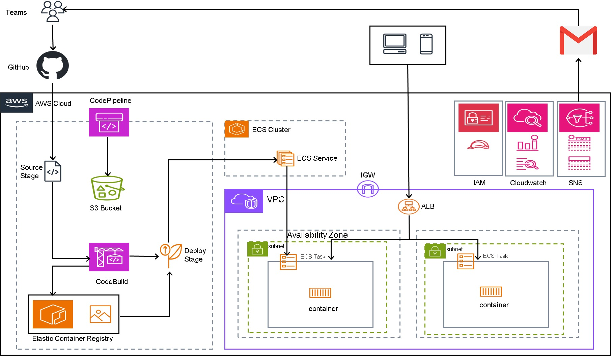

# AWS ECS Fargate CI/CD Infrastructure (Modular Terraform)

Modular Terraform configuration to provision the AWS infrastructure and CodePipeline CI/CD workflow for deploying the containerized Flask application to Amazon ECS Fargate behind an Application Load Balancer.

## Architecture Overview



## Module Structure

```text
terraform-scripts-quiz-project/
├── main.tf                      # Root orchestrator wiring all child modules
├── providers.tf                 # Terraform version constraints, AWS provider & optional S3 backend
├── variables.tf                 # Root input variable definitions
├── outputs.tf                   # Root outputs (ALB DNS, VPC, ECR, ECS, CodePipeline)
├── codepipeline-connection.tf   # AWS CodeStar GitHub connection
├── terraform.tfvars.example     # Safe example variable file (copy to terraform.tfvars locally)
├── alb/                         # Application Load Balancer, Target Group & HTTP Listener
├── cloudwatch/                  # ECS & CodeBuild Log Groups, Container Insights Dashboard & Alarms
├── codebuild/                   # CodeBuild Docker image build & ECR push project
├── codepipeline/                # CodePipeline (Source -> Build -> ECS Deploy) + Notification Rule
├── ecr/                         # Amazon ECR repository with scan-on-push enabled
├── ecs/                         # ECS Fargate Cluster, Task Definition & Service
├── iam/                         # Least-privilege IAM roles/policies for ECS, CodeBuild & CodePipeline
├── s3/                          # Private S3 bucket for pipeline/build artifacts
├── security_group/              # Isolated ALB (port 80) and ECS (port 5000 from ALB only) SGs
├── sns/                         # SNS alerting topic & optional email subscription
└── vpc/                         # VPC, 2 Public Subnets, Internet Gateway & Route Table
```

## Usage

1. Install [Terraform](https://developer.hashicorp.com/terraform/downloads) (`>= 1.5.0`) and configure AWS credentials (`aws configure` or environment variables).
2. Clone the repository and copy the example variables file:
   ```bash
   cp terraform.tfvars.example terraform.tfvars
   ```
3. Edit `terraform.tfvars` with your `aws_account_id`, unique `bucket_name`, and optional `notification_email`.
4. Initialize, validate, plan, and apply:
   ```bash
   terraform init
   terraform validate
   terraform plan -out=tfplan
   terraform apply tfplan
   ```
5. Complete the pending GitHub connection handshake in **AWS Console -> Developer Tools -> Settings -> Connections** so CodePipeline can fetch source commits.
6. Tear down all resources when finished to avoid charges:
   ```bash
   terraform destroy
   ```

## License

This project is licensed under the [MIT License](LICENSE).
